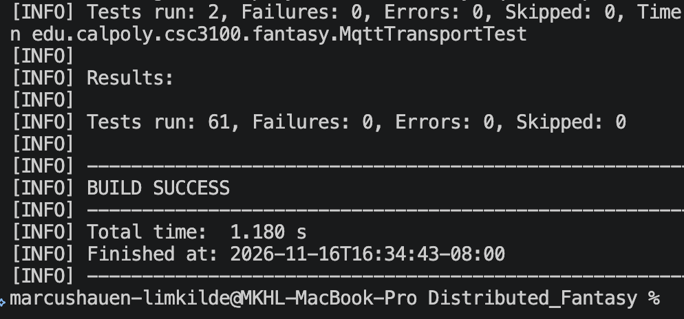

# CSC 3100 — A04 Distributed Fantasy Adventure

[](https://github.com/anthony-Soto/Distributed_Fantasy/actions/workflows/ci.yml)

Two Java Swing clients, one in IntelliJ and one in Docker/noVNC, share two fantasy characters through MQTT. Built with TDD against the instructor acceptance suite plus three team tests.

## Team

| Partner | Responsibilities |
|---|---|
| Marcus Hauen-Limkilde (Partner A) | One-tile movement and Blackboard events; Sword/Shield/Shoes decorators; equipment changes |
| Anthony Soto (Partner B) | Snapshot decoding (`PlayerCodec`); subscriber handling (`IncomingPlayerHandler`); MQTT synchronization and Docker/noVNC demo |

Both partners chose and wrote the three tests in `StudentAcceptanceTest.java` and reviewed each other's pull requests.

## Run our demo

Requirements: Java 21, Maven, and Docker Desktop (or Docker Engine with Compose). Both clients must use the same `TEAM` and different `PLAYER` names.

| Variable | Local client | Docker client |
|---|---|---|
| `TEAM` | `df-a04-k7q2` | `df-a04-k7q2` |
| `PLAYER` | `alice` | `bob` |

1. **Local client (Alice).** In IntelliJ, run `edu.calpoly.csc3100.fantasy.Main` with environment variables `TEAM=df-a04-k7q2;PLAYER=alice`, or from a terminal:

   ```sh
   TEAM=df-a04-k7q2 PLAYER=alice mvn compile exec:java
   ```

2. **Docker client (Bob).** In a second terminal:

   ```sh
   mvn -B package
   TEAM=df-a04-k7q2 PLAYER=bob docker compose up --build
   ```

3. **Open noVNC** at <http://localhost:6080/vnc.html?autoconnect=1> and click the board.

Use the arrow keys to move the local player one tile and the checkboxes to add or remove Sword, Shield, and Shoes. Changes from either client appear on both boards. When finished, close the Swing window and run `docker compose down`.

## Run the tests

```sh
mvn -B -Djava.awt.headless=true test
```

61 tests: the 58 instructor acceptance cases plus 3 team tests in `StudentAcceptanceTest.java`.

## Evidence

**Both players on both boards** (IntelliJ client and Docker/noVNC client):


**Passing test suite** (61 run, 0 failures, 0 errors):



---

## Learning goals

Implement Factory, Decorator, and Observer patterns; synchronize two Java Swing clients through MQTT; practice test-driven development and GitHub Actions CI/CD; package a JAR and run the same GUI in Docker through noVNC.

## Required demonstration

Use Java 21, Maven, and a running Docker Desktop or Docker Engine with Compose. Run the demo after the full test suite passes. Pick a unique team ID and use it in both clients. Choose a different player name for each client.

1. Open the Maven project in IntelliJ and select JDK 21. Run `edu.calpoly.csc3100.fantasy.Main` with environment variables `TEAM=your-team` and `PLAYER=alice`. You can also launch the same client from the IntelliJ terminal.

   ```sh
   TEAM=your-team PLAYER=alice mvn exec:java
   ```

2. In a second terminal, package the JAR and start the Docker client.

   ```sh
   mvn -B package
   TEAM=your-team PLAYER=bob docker compose up --build
   ```

3. Open [noVNC](http://localhost:6080/vnc.html?autoconnect=1) and click the Swing board to give the remote desktop keyboard focus. If the board is clipped, widen the browser window.

### What to show

- Identify Alice and Bob on both boards. They start on the same tile, so their drawings can overlap until one player moves.
- In the local window, press an arrow key once. Show Alice move one tile in both windows. Repeat from the browser for Bob.
- Use the equipment checkboxes to add Sword, Shield, and Shoes. Show each overlay on both boards. Remove one item while others are equipped and show that only its overlay disappears. Demonstrate an equipment change from each client.
- Show the passing JUnit run, including your three tests, and the successful GitHub Actions run.

When you finish, close the local Swing window and run `docker compose down` in the project directory.

## Architecture contract

- **Factory:** creates the base fantasy character.
- **Decorator:** composes Sword, Shield, and Shoes at runtime; draw methods compose visually as well as behaviorally.
- **Blackboard:** extends `PropertyChangeSupport` and owns the authoritative local view of player states. Preserve this inheritance-based lecture design.
- **Observer:** Swing listens to Blackboard changes and repaints on the Swing event-dispatch thread.
- **Publisher:** sends local player-state updates to the public HiveMQ broker.
- **Subscriber:** receives remote player-state updates and updates Blackboard without republishing.
- **MQTT:** `tcp://broker.hivemq.com:1883`, QoS 1, retained state on `csc3100/a04/<team>/players/<username>`; subscribe using the team wildcard. Use unique team and player identifiers. Retained state is not an online-presence indicator; disconnected players remain at their last reported position.

## TDD and submission

The instructor provides most JUnit 5 acceptance tests. Students must **add exactly three meaningful JUnit 5 tests** in a separate `StudentAcceptanceTest.java` file for features of their choice. Keep the instructor tests intact. Implement functionality by making tests pass, and keep tests independent of the live public broker using test doubles. The CI workflow must run tests before packaging the executable JAR, building the Docker image, and smoke-testing the noVNC endpoint and Java process. The instructor provides the Dockerfile, Compose, workflow, and noVNC configuration; students implement application functionality, not infrastructure.

### Starter-template status

Run `mvn -B test-compile` to verify that the untouched starter and tests compile. Then run `mvn -B -Djava.awt.headless=true test`. The untouched starter runs 58 instructor cases with 33 passes, 23 assertion failures, 2 decode-stub errors, and 0 skips. Use those failures to guide the TODOs in Blackboard, the decorators, PlayerCodec, and IncomingPlayerHandler. The instructor branch includes a `.starter-template` marker so CI can package and smoke-test the starter while its acceptance tests are intentionally failing. Delete that marker in your first team PR to require the full JUnit suite before packaging and building the image. The CI smoke test uses a private broker and checks the noVNC page, Java process, and Swing window.

### Behavior covered by the instructor tests

- Arrow keys move the local player one tile on a 16-column by 11-row board. Ignore zero, diagonal, multi-tile, and out-of-bounds commands. Local commands can only edit the local player.
- Equipment IDs are `sword`, `shield`, and `shoes`. Add each at most once and preserve the order of remaining items on removal. Ignore unknown IDs and attempts to remove absent items. Sword adds 5 attack, Shield adds 5 defense, and Shoes are visual only.
- Draw the wrapped character first, then draw the overlay within its 40-pixel tile. Keep Sword on the right, Shield on the left, and Shoes below the body so the overlays can be seen together.
- Each changed local snapshot produces one `players` event with the prior and new snapshots and one publish. Remote changes produce the same observer event without a publish. An identical remote snapshot produces no event. The Swing application applies incoming snapshots on the event-dispatch thread.
- The receiver accepts a UTF-8 JSON snapshot only when the team topic and player suffix match, the state is valid, and the player is remote. Reject malformed or incomplete snapshots, unsupported types and equipment, duplicate equipment, and coordinates outside the board. Ignore a bad message and continue receiving.

## Implementation checklist for instructor preparation

- [x] Refactor `GameModel` into observable `Blackboard extends PropertyChangeSupport`.
- [x] Add runtime removal and Shoes; test decorator drawing delegation.
- [x] Separate `Publisher` and `Subscriber`, preserving MQTT protocol and preventing echoes.
- [x] Render decorated players in the shared Swing board and support one-tile commands.
- [x] Replace Docker console mode with Swing + Xvfb + lightweight desktop + noVNC.
- [x] Provide complete instructor acceptance tests and require exactly three additional student tests.
- [x] Update CI to test, package, build container, and smoke-test noVNC.
- [x] Verify IDE ↔ Docker bidirectional MQTT demonstration.
